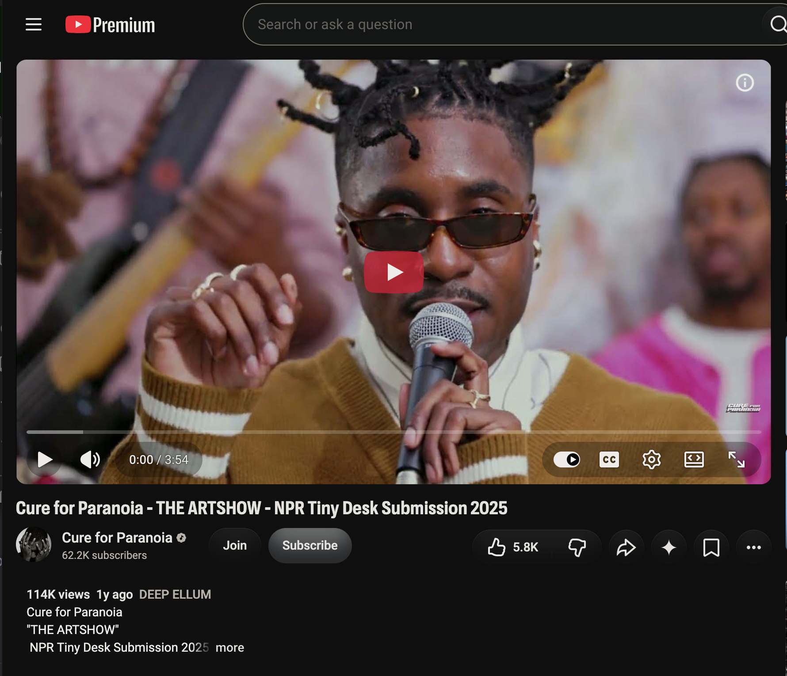

<p align="center">
  
</p>

# Village Alchemist / Artshow

An independent home for illustrated sagas and other experiments by MJ.
Plain HTML and CSS, served by Cloudflare Workers Static Assets.

- `/`: the art collection
- `/hereeesjohnnyson/`: The Uncast Twins
- `/hereeesjohnnyson/issue-01/`: free Issue #001, Beyond the Stanley

The five approved comic pages are preserved byte for byte. The reader uses
continuous scrolling, native page links, full-size image links, and expandable
page descriptions and dialogue. No browser JavaScript, third-party fonts,
tracking, or runtime dependencies are needed.

## Develop

Use Node 26 and npm.

```sh
npm ci
npm run check
npm run dev
```

The local site runs at `http://localhost:42069`. Rebuild after editing HTML or
CSS. `npm run check` runs the source policy, strict TypeScript, ESLint, Prettier,
build-guard tests, and the deterministic static build.

`scripts/site.ts` defines the explicit public-file allowlist. `npm run build`
cleans `dist`, copies only those files, verifies artwork hashes and page order,
and checks local links and anchors. The README image in `ASSets/` is repository
material, not a deployed site asset. Private photographs and source archives
must stay outside this repository.

## Publish

The production branch is `mainframe`. The dedicated Worker is
`villagealchemist-art`. This project does not deploy or alter the existing
`villagealchemist` Worker or `villagealchemist.com`.

```sh
npm run check
npm run deploy -- --dry-run
npx wrangler whoami
npm run deploy
```

Verify the intended Cloudflare account before deploying. The config initially
publishes only to the Worker's `workers.dev` address. The intended custom domain
is `villagealchemist.art`, but domain routing must be explicitly approved and
verified before adding it to `wrangler.jsonc`. A repository name does not bind a
domain. See [deployment notes](docs/deployment.md).

GitHub Actions runs checks and a deployment dry run on pull requests and pushes.
It does not publish. Cloudflare Builds can later be connected to this repo using
`mainframe`, build command `npm run check`, and deploy command `npm run deploy`.

## Add an issue

Keep each issue under `/hereeesjohnnyson/issue-NN/`. Add only approved public
artwork to the build allowlist, preserve its proportions, and keep the reader
usable without scripts. Update the saga index when the new issue is ready.
